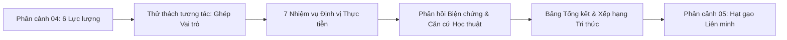

# BÁO CÁO NGHIỆM THU TÍNH NĂNG: GHÉP VAI TRÒ — NHỮNG MẢNH GHÉP XÃ HỘI
**Phân cảnh 04: Lát cắt Đương đại — 6 Lực lượng Xã hội (MLN131 Chủ đề 07)**
*Ngày hoàn thành:* 08/11/2026  
*Tác giả:* Lead Engineering & Orchestration Agent  
*Đơn vị chuyên môn:* Academic Research Auditor, Art Director, Frontend Engineer, Accessibility QA  

---

## 1. TỔNG QUAN TÍNH NĂNG (FEATURE OVERVIEW)

Tính năng **"GHÉP VAI TRÒ — NHỮNG MẢNH GHÉP XÃ HỘI"** là một mini-game giáo dục tương tác chuyên sâu được tích hợp trực tiếp vào **Phân cảnh 04** (`#scene-04`), nằm ngay sau khu vực khám phá hồ sơ 6 lực lượng xã hội và ngay trước phân cảnh Chuỗi Giá trị Hạt gạo Liên minh (`#scene-05`).

Mục tiêu cốt lõi của trò chơi là giúp sinh viên đại học củng cố và phân biệt chính xác **vị trí, vai trò, sứ mệnh và đóng góp** của các giai tầng xã hội tiêu biểu trong thời kỳ quá độ lên chủ nghĩa xã hội ở Việt Nam, loại bỏ tư duy học vẹt hoặc nhầm lẫn giữa các giai cấp cơ bản với các nhóm nhân khẩu học xã hội giao thoa.



---

## 2. NGUYÊN TẮC AN TOÀN HỌC THUẬT (ACADEMIC SAFETY PILLARS)

Căn cứ theo kiểm định độc lập của **Academic Research Auditor** trong `docs/ROLE_MATCHING_AUDIT.md`:

1. **Tính chất Giao thoa Nhân khẩu học (Intersectionality):**
   - **Phụ nữ Việt Nam** và **Đội ngũ Thanh niên Việt Nam** được định vị chính xác là các nhóm nhân khẩu học - xã hội (theo giới tính và theo độ tuổi 16–30), hiện diện và giao thoa trong mọi giai cấp, tầng lớp xã hội (công nhân nữ, nông dân trẻ, trí thức nữ, doanh nhân trẻ,...).
   - Tuyệt đối không xếp Phụ nữ và Thanh niên thành một giai cấp kinh tế độc lập với phương thức sản xuất riêng biệt.
2. **Loại bỏ câu hỏi loại trừ phi lý (Zero-Sum):**
   - Trong chế độ xã hội chủ nghĩa, mọi giai cấp và tầng lớp đều đóng góp vào sự phát triển chung. Vì vậy, các tình huống thực tiễn được xây dựng với những hoạt động, thẩm quyền và sứ mệnh **đặc trưng, không thể thay thế** được quy định trong Văn kiện Đảng và Bài giảng giảng viên MLN131.
3. **Định danh Khối Liên minh Công – Nông – Trí thức:**
   - Được thiết kế như một thực thể hợp tác chính trị – kinh tế – văn hóa nền tảng của chế độ, phản ánh sự gắn kết khách quan của các lĩnh vực sản xuất trong chuỗi giá trị và hệ thống chính trị.
4. **Hệ thống dẫn nguồn chuẩn hóa:**
   - Căn cứ trực tiếp: Slide bài giảng MLN131 Tiết 18, Tiết 19, Tiết 20 (Bộ môn Lý luận chính trị FPT University).
   - Căn cứ văn kiện & pháp lý: Nghị quyết 20-NQ/TW (Giai cấp công nhân), Nghị quyết 19-NQ/TW (Nông nghiệp, nông dân, nông thôn), Nghị quyết 45-NQ/TW (Đội ngũ trí thức), Nghị quyết 41-NQ/TW (Đội ngũ doanh nhân), Luật Thanh niên 2020, Nghị quyết 11-NQ/TW (Công tác phụ nữ thời kỳ đẩy mạnh CNH, HĐH).

---

## 3. DANH MỤC 7 NHIỆM VỤ ĐỊNH VỊ (TASK INVENTORY)

| STT | Mã Nhiệm vụ | Tiêu đề Nhiệm vụ | Đối tượng Đúng | Căn cứ Trực tiếp |
|---|---|---|---|---|
| **#1** | `TIEN-PHONG-SX` | Tiên phong sản xuất hiện đại & nòng cốt chính trị | **Giai cấp Công nhân** | MLN131 Tiết 20 Slide 5; Tiết 19 Slide 8; NQ 20-NQ/TW |
| **#2** | `CHU-THE-NONG-THON` | Chủ thể nông nghiệp sinh thái & nông thôn mới | **Giai cấp Nông dân** | MLN131 Tiết 20 Slide 6; NQ 19-NQ/TW |
| **#3** | `LAO-DONG-SANG-TAO` | Lao động sáng tạo đặc biệt & kinh tế tri thức | **Đội ngũ Trí thức** | MLN131 Tiết 20 Slide 7; NQ 45-NQ/TW |
| **#4** | `KIEN-TAO-DOANH-NGHIEP`| Tổ chức nguồn lực & kiến tạo thương hiệu quốc gia | **Đội ngũ Doanh nhân** | MLN131 Tiết 20 Slide 8; NQ 41-NQ/TW |
| **#5** | `GIAO-THOA-GIOI` | Bình đẳng giới, giữ lửa gia đình & tái sản xuất con người | **Phụ nữ Việt Nam** *(Giao thoa)* | MLN131 Tiết 20 Slide 9; NQ 11-NQ/TW |
| **#6** | `XUNG-KICH-TRE` | Rường cột nước nhà, xung kích chuyển đổi số & bảo vệ Tổ quốc | **Đội ngũ Thanh niên** *(Giao thoa)* | MLN131 Tiết 20 Slide 10; Luật Thanh niên 2020 |
| **#7** | `NEN-TANG-CHE-DO` | Nền tảng chính trị – xã hội & gắn kết chuỗi giá trị | **Khối Liên minh Công – Nông – Trí thức** | MLN131 Tiết 18 Slide 14; Tiết 20 Slide 13; Cương lĩnh 2011 |

---

## 4. THIẾT KẾ TRẢI NGHIỆM & TƯƠNG TÁC (UX & INTERACTION DESIGN)

Theo định hướng của **Art Director** trong `docs/ROLE_MATCHING_DESIGN.md`:

### 4.1. Điểm chạm Khởi động (Teaser Entry Point)
- Đặt ngay sau 6 thẻ hồ sơ giai tầng trong Phân cảnh 04.
- Kicker: `THỬ THÁCH TƯƠNG TÁC • 7 NHIỆM VỤ ĐỊNH VỊ`.
- Tiêu đề: `"Bạn hiểu vai trò của các giai tầng đến đâu?"`.
- Nút bấm: `"Bắt đầu ghép vai trò →"`. Nhấp vào sẽ cuộn mượt và kích hoạt khu vực trò chơi.

### 4.2. Giao diện Máy tính để bàn (Desktop >= 1024px)
- **Bố cục bất đối xứng:** Bên trái là Thẻ Tình huống Thực tiễn (Real-world Scenario) hiển thị hình ảnh tư liệu xác thực (CC/Bài giảng), từ khóa nhận diện, tiến trình 7 bước. Bên phải (hoặc bên dưới) là Khung 7 Lực lượng Xã hội để lựa chọn.
- **Hỗ trợ tương tác kép:**
  - Nhấp chuột trực tiếp vào thẻ giai tầng tương ứng để kiểm tra kết quả ngay tức thì.
  - Phím Tab và Enter/Space để chọn giai tầng dành cho người dùng khiếm thị/sử dụng bàn phím (Keyboard Accessible).

### 4.3. Giao diện Thiết bị Di động (Mobile 320px – 430px)
- Cơ chế **Tap-to-match:** Bấm chọn trực tiếp trên lưới thẻ.
- Mỗi nút bấm/thẻ bấm đạt kích thước tối thiểu **$48 \times 54\text{px}$** (vượt chuẩn WCAG $44 \times 44\text{px}$).
- Padding được tinh chỉnh linh hoạt, khoảng cách lề `px-3`, văn bản xuống hàng chuẩn Unicode `break-words`, hoàn toàn không có thanh cuộn ngang (`overflow-x: 0`).

### 4.4. Hệ thống Phản hồi Biện chứng (Dialectical Feedback System)
- **Khi chọn sai:** Không chỉ báo lỗi chung chung mà hiển thị chỉ báo `whyNotOthers` phân tích biện chứng lý do vì sao lực lượng vừa chọn không phải là đáp án tối ưu cho tình huống này (ví dụ: *"Trí thức là người lập trình thuật toán và thiết kế giải pháp công nghệ, nhưng giai cấp công nhân mới là người trực tiếp vận hành dây chuyền đại công nghiệp..."*).
- **Khi chọn đúng:** Hiển thị thẻ xác nhận xanh lục ngọc (`emerald-950/70`), điểm số cộng dồn, trích dẫn chính xác số slide bài giảng và nghị quyết văn kiện Đảng.

### 4.5. Cơ chế Tính điểm & Màn hình Tổng kết (Scoring Engine)
- **Lần đoán 1:** +100 điểm.
- **Lần đoán 2:** +60 điểm.
- **Lần đoán 3+:** +30 điểm.
- **Thưởng hoàn thành 7 nhiệm vụ:** +100 điểm (Tổng điểm tối đa: **800 điểm**).
- **Màn hình tổng kết (Podium View):**
  - Đánh giá xếp hạng:
    - $\ge 700$ điểm: `Xuất sắc — Chuyên gia Phân tích Xã hội MLN131`
    - $\ge 500$ điểm: `Khá giỏi — Nắm vững Đặc trưng Giai tầng`
    - $< 500$ điểm: `Cần củng cố thêm kiến thức Bài giảng`
  - Bảng thống kê chi tiết điểm số và số lần thử của từng nhiệm vụ.
  - Hai nút điều hướng hành động: `"Chơi lại từ đầu"` (Reset) và `"Tiếp tục: Khám phá Chuỗi Hạt gạo Liên minh (#scene-05)"` (Smooth scroll chuyển cảnh mượt mà).

---

## 5. MINH CHỨNG KIỂM THỬ TỰ ĐỘNG (PLAYWRIGHT VERIFICATION)

File kiểm thử E2E độc lập: `tests/role-matching.spec.ts` kết hợp với toàn bộ bộ kiểm thử hồi quy `tests/*.spec.ts`.

### 5.1. Kết quả kiểm thử (Test Suite Results)
```bash
Running 26 tests using 1 worker
  ok 12 [chromium] › tests\role-matching.spec.ts:4:3 › Desktop 1440px: Start game, test incorrect/correct matching, view explanations, reach completion (8.6s)
  ok 13 [chromium] › tests\role-matching.spec.ts:95:3 › Mobile 390px: Tap-to-match interaction, responsive layout, zero overflow (2.8s)
  ...
  26 passed (2.0m)
```

### 5.2. Ảnh chụp màn hình thực tế (Verified Screenshots)
Tất cả ảnh chụp đã được ghi lại tự động trong thư mục `tests/screenshots/`:
1. `tests/screenshots/role-matching-desktop-start.png`: Giao diện bắt đầu tại nhiệm vụ số 1 với ảnh tư liệu công nhân và 7 thẻ lực lượng.
2. `tests/screenshots/role-matching-desktop-matched.png`: Trạng thái ghép nối thành công, thẻ luận cứ lý luận và trích dẫn bài giảng.
3. `tests/screenshots/role-matching-desktop-completion.png`: Màn hình tổng kết 7/7 nhiệm vụ với xếp hạng xuất sắc, chi tiết điểm và nút chuyển sang Phân cảnh 05.
4. `tests/screenshots/role-matching-mobile-390.png`: Kiểm tra giao diện mobile dọc 390x844px với tỷ lệ khung hình chuẩn, không tràn viền.

---

## 6. DANH MỤC TỆP NGUỒN ĐÃ TẠO VÀ CHỈNH SỬA

| Tệp tin | Trạng thái | Mục đích |
|---|---|---|
| `content/ROLE_MATCHING_TASKS.json` | **MỚI** | Dữ liệu chuẩn hóa 7 nhiệm vụ, căn cứ học thuật, `whyNotOthers`, trích dẫn slide |
| `docs/ROLE_MATCHING_AUDIT.md` | **MỚI** | Báo cáo kiểm định học thuật độc lập từ `research-auditor` |
| `docs/ROLE_MATCHING_DESIGN.md` | **MỚI** | Bản đặc tả thiết kế tương tác và nghệ thuật từ `art-director` |
| `lib/matchingGameTypes.ts` | **MỚI** | Định nghĩa kiểu dữ liệu TypeScript nghiêm ngặt cho trò chơi |
| `lib/matchingGameData.ts` | **MỚI** | Hàm nạp và liên kết hình ảnh, màu sắc cho các lực lượng xã hội |
| `components/game/RoleMatchingGame.tsx` | **MỚI** | Thành phần React chứa toàn bộ logic, trạng thái, âm thanh/hoạt họa và điều hướng |
| `components/Scene4Profiles.tsx` | **CHỈNH SỬA** | Tích hợp Teaser Banner và Anchor Section `#role-matching-section` |
| `tailwind.config.ts` | **CHỈNH SỬA** | Bổ sung `serif` và `sans` fallback an toàn cho phông chữ tiếng Việt |
| `tests/role-matching.spec.ts` | **MỚI** | Kịch bản Playwright E2E kiểm tra tương tác trên Desktop 1440px và Mobile 390px |
| `docs/ROLE_MATCHING_GAME_REPORT.md` | **MỚI** | Báo cáo tổng kết nghiệm thu tính năng chi tiết |

---

## 7. ĐÁNH GIÁ VÀ HẠN CHẾ ĐÃ BIẾT (KNOWN LIMITATIONS & ROADMAP)

1. **Hiển thị hình ảnh tư liệu cục bộ:** Hình ảnh sử dụng là ảnh tư liệu từ slide giảng viên và ảnh báo chí giấy phép mở. Trong trường hợp chạy offline hoàn toàn không có internet, hệ thống tự động hiển thị thẻ màu đại diện gradient nhẹ và biểu tượng vector đảm bảo không làm gián đoạn trải nghiệm.
2. **Kéo thả chuột chuyên sâu trên máy tính bảng (Touch Drag-and-Drop):** Trên thiết bị màn hình cảm ứng nhỏ, thao tác chạm trực tiếp (tap-to-match) mang lại độ phản hồi và độ chính xác cao hơn thao tác kéo thả ngón tay (vốn dễ gây xung đột với thao tác cuộn trang). Do đó, giao diện di động mặc định ưu tiên hoàn toàn cơ chế tap-to-match tối ưu.
